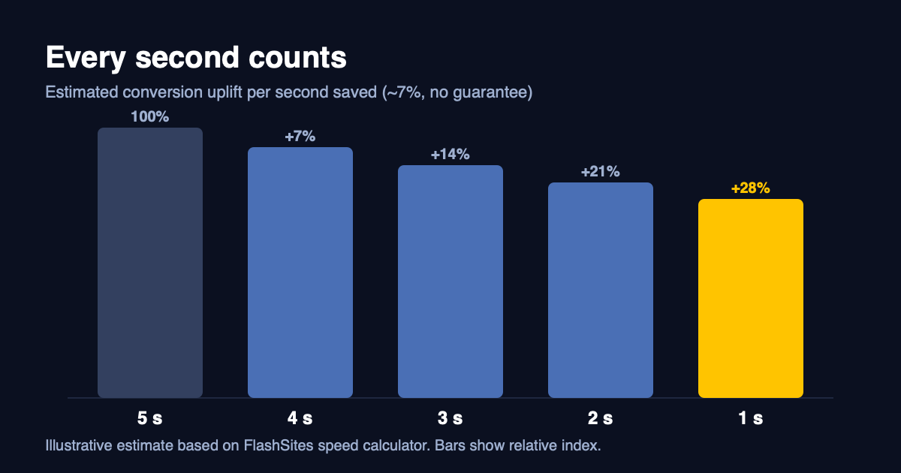
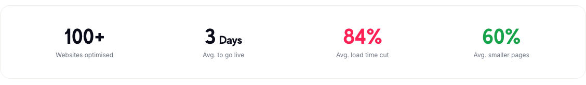

# Your shop loads in 4 seconds. Here's what that costs you.

Most shop owners know their site could be faster. Few know what it's costing them, because nobody sends you an invoice for the customers who left before the page finished loading. They just vanish. Your analytics shows a bounce, and you move on to the next thing.

We've been working on this problem for a while now, building a setup that makes shops fast without asking owners to rebuild anything. This post is the plain version of what we've learned about why shops are slow and what it's worth fixing.

## The rule of thumb

We have a speed calculator on our site, and it runs on a simple assumption: every second you shave off the load time brings roughly 7% more conversions.

That number is an estimate, and I don't want to oversell it. It's not a promise, and your shop might do better or worse depending on your audience and what you sell. But run it against your own traffic anyway. If you do 1,000 orders a month and you're at four seconds, even a fraction of that uplift is real money you're leaving on the table every single month.

## Where the time actually goes

When we open a slow shop for the first time, it's almost never one big problem. It's a pile of small ones that built up over the years.

Product photos uploaded straight from the camera. Six apps that each bring their own JavaScript. A chat widget, a review plugin and a handful of trackers, all fighting for the browser's attention at the same moment. Old fonts that weigh far more than they need to. And a server that rebuilds the same product page from scratch for every visitor, even though nothing on it has changed since yesterday.

None of this is anybody's fault. Every plugin made sense on the day it was installed. Nobody goes back and asks what the whole thing weighs now.

## Test with real visitors, not a lab

A speed test run from a data center on a fast connection will flatter you. Your customers are on a train with one bar of signal, or on a five-year-old phone, or both.

That's why we measure with Real User Monitoring, which means numbers from actual visitors on actual devices, alongside Google PageSpeed. The lab score is a useful hint. The real-user number is what tells you whether people are waiting.

We also keep watching after the work is done. A fast launch week means very little if the shop has crept back to slow by March, because somebody added another app.

## What this looks like across our projects

Across the 100+ websites we've optimised so far, the averages look like this:

*Source: flashsites.de/en/customers*

Three days to go live, 84% less load time on average, and pages about 60% smaller. Averages hide a lot, of course, and some shops improve far more than others. A couple of the bigger jumps are in our [case studies post](3-offgridtec-case-study.md).

## Where I'd start

If you're going to do this yourself, here's the order I'd go in.

First, find out how long your pages really take for real visitors, on mobile. Second, look at images, since they're usually the heaviest thing on the page. Third, count your third-party scripts. People are often surprised by the number. After that, look at whether your server is rebuilding pages it doesn't need to.

You don't need to touch your theme for most of this.

And if you'd rather hand it over, that's what we do. Fill in your URL on [flashsites.de](https://flashsites.de/en/), we try it for 14 days, and if you're not convinced you pay nothing.
