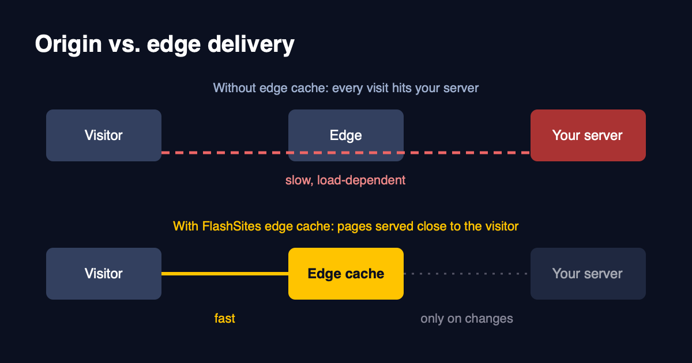
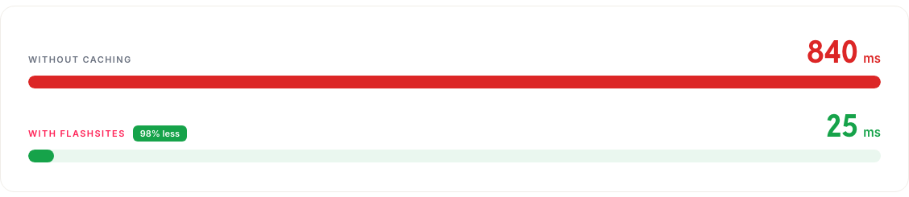

# Why your server shouldn't build every page, every time

Think about what happens when someone opens a product page on your shop. Your server wakes up, asks the database a handful of questions, runs your theme, glues everything together and sends the result back. Then the next visitor arrives and it does the whole thing again, for a page that looks exactly the same.

On a quiet Tuesday you won't notice. During a newsletter send, a sale or a mention somewhere popular, you will. The server gets busier, every page gets slower, and the visitors you worked hardest to get are the ones who wait the longest.

## What an edge cache does

An edge cache keeps a finished copy of the page on a server close to the visitor. Someone in Munich asks for your page and gets the stored copy straight away. Your own server only gets involved when something has changed.

On our caching page we show the difference with a simple comparison, and I think it makes the point better than I can with words:

*Source: flashsites.de/en/caching*

840 milliseconds without caching, 25 with it. That's 98% less waiting, and the visitor feels it on every single click.

The way it works is pretty simple. The first time a page is requested, it gets rendered and stored. Every visitor after that gets the stored version. Your hosting gets a break, and a traffic spike stops being something to dread.

## The catch is keeping it current

Putting pages in a cache is easy. Knowing when a copy has gone stale is the hard part.

Say you change a price. If the cached page still shows the old one for the next hour, that's not a small bug. It's a customer who sees one price in the shop and another at checkout, and that is a support ticket you didn't need.

The lazy answer is to wipe the whole cache after every change. It's safe, but you've thrown away the speed you set the cache up for. After a big product import, your shop is cold and slow all over again, right when you'd want it fast.

What we aim for is the opposite: update what changed and leave the rest alone. Change your content or your prices and the page is current again within seconds. With Offgridtec, a Shopware shop, product updates clear only the affected articles from the cache. Everything else stays cached and keeps being fast.

## What we never cache

Some things should never come from a shared cache. The cart, the checkout and the customer account are personal, so they go straight to your server every time. If a setup caches those, something is wrong, and you'd hear about it quickly from customers.

## How to tell whether your cache is any good

Don't judge it by the hit rate alone. A high hit rate sounds great and can still hide pages that are slow for real visitors. Look at how fast the shop feels on a phone on mobile data, and check how quickly a price change shows up. If both are good, you're in decent shape.

## No theme changes

None of this needs changes to your theme or code, and we're usually live in around three days. If you'd like to see what it does for your shop, [try it free for 14 days](https://flashsites.de/en/).
