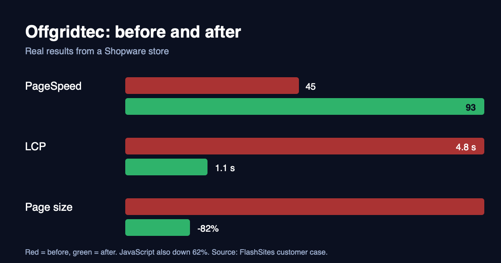
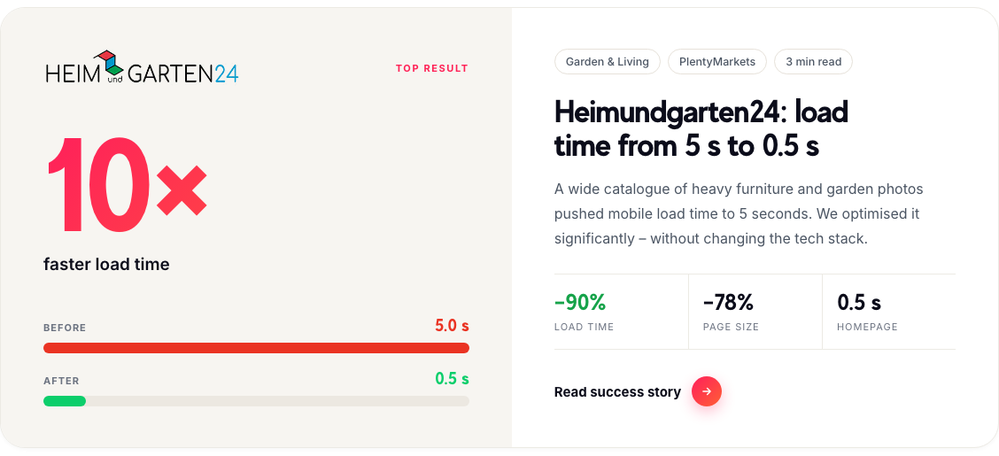

# Four shops, four slow pages, and what fixed them

People ask us what the results look like in practice, so here are four real shops, what was slowing each of them down, and where they ended up. Different platforms, different problems. If yours looks like one of these, you'll know roughly what to expect.

All the numbers are from our [customers page](https://flashsites.de/en/customers), measured with Real User Monitoring and Google PageSpeed.

## Offgridtec: PageSpeed from 45 to 93

Offgridtec sells off-grid and solar gear from a Shopware shop. A big catalogue, plenty of product images and scripts that had piled up over time.

When we started, the PageSpeed score was 45 and Largest Contentful Paint was 4.8 seconds. That second number is the one to watch, since it's roughly how long a visitor stares at an unfinished page before the main content turns up.

| | Before | After |
|---|---|---|
| PageSpeed score | 45 | 93 |
| Largest Contentful Paint | 4.8 s | 1.1 s |
| Page size | | 82% smaller |
| JavaScript | | 62% less |

What I find most useful about this one is how updates are handled. Offgridtec changes articles in Shopware all the time, and nobody wants a customer looking at an old price. So each update clears only the articles that changed, automatically, and the rest of the shop stays in the cache.

## Heimundgarten24: from 5 seconds to 0.5

*Source: flashsites.de/en/customers*

This is the biggest jump we've had. Heimundgarten24 runs on plentymarkets and sells furniture and garden products, which means a huge catalogue of heavy photos. On mobile, a page took about 5 seconds to load.

After the work, load time was down 90%, page size down 78%, and the homepage opens in 0.5 seconds. And we didn't change their tech stack to get there.

## Teppichscheune: when the photos are the product

Teppichscheune makes rugs to measure, on Shopware 6. High-resolution rug photos are the heart of the shop, and they were also its biggest drag. Pages took around 5 seconds.

The image pipeline did most of the work here. One example image went from 840 KB to 92 KB, which is 89% smaller, with no visible loss of quality. Pages now load in about 0.8 seconds.

Their technical lead put it simply: "FlashSites helped us improve our site's load times considerably."

## Superwurm: a Next.js shop with lots of pages

Superwurm sells worm compost and garden products, built on Next.js, with a lot of category and guide pages. On mobile, every page change tested your patience. Load time went from 3.9 seconds to 0.9.

Their managing director, Marvin Langhoff, said: "Since FlashSites optimised our page speed, our site has become extremely fast."

## What the four have in common

There's no single trick behind any of these. We look at the whole page, not only caching or only images, and fix whatever is costing time on that particular site.

The other thing they share is that none of them needed a rebuild. Shopware, plentymarkets, Next.js: different platforms, same approach.

If your shop sounds like one of these, send us the URL. The trial is 14 days and free, and you only pay if you're convinced.
