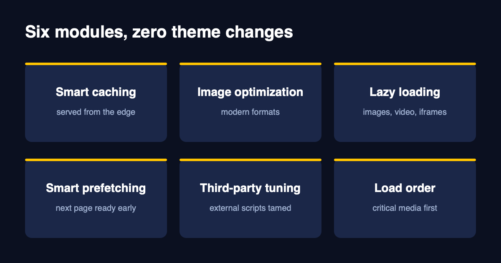
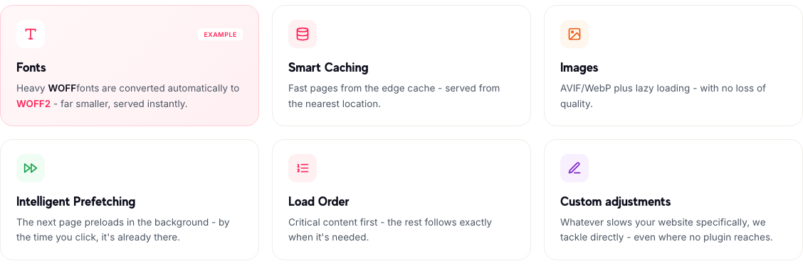
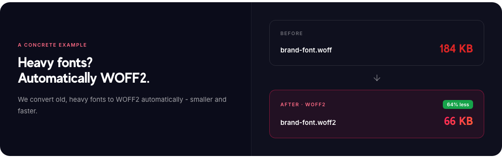
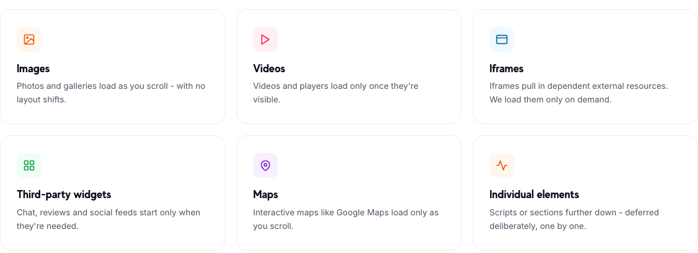
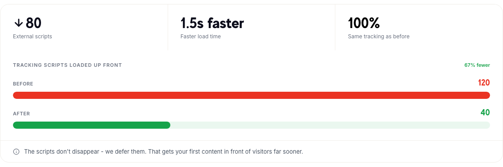
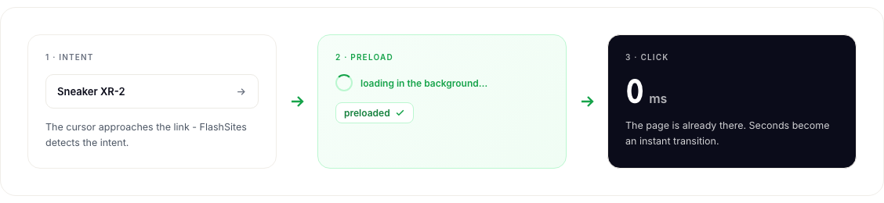

# Caching gets you most of the way. Here's the rest.

People hear "speed optimisation" and think of caching, which makes sense, since it's the biggest single win. But a shop can be cached and still feel clumsy. Here's the rest of what we work on, and why each piece matters.

We call our approach tailor-made, and I mean that literally. A standard plugin applies one setup to every website and picks off the obvious wins. We look at the whole page and decide what each part needs.

*Source: flashsites.de/en/pagespeed-solution*

## Images: same quality, up to 92% smaller

Images are usually the heaviest thing on a page. We compress them automatically, serve modern formats like AVIF and WebP, and resize them so a phone doesn't download a desktop-sized photo. Optimised images stay in the cache, so they're ready straight away. On one of our customer shops, an image went from 840 KB to 92 KB and nobody could see a difference.

## Fonts: a small fix that surprises people

Old WOFF fonts are heavier than they need to be. We convert them to WOFF2 automatically.

*Source: flashsites.de/en/pagespeed-solution*

In the example on our site, a font drops from 184 KB to 66 KB, 64% less. One font is small, but shops often load several, and it adds up.

## Lazy loading: only what the visitor can see

A visitor lands at the top of the page. There's no reason to download the video, the map or the review widget at the bottom yet.

Most lazy loading stops at images. We go further, and defer videos, iframes, chat and review widgets, maps and individual scripts too. And we decide element by element, not with one blanket rule.

*Source: flashsites.de/en/lazy-loading*

The idea is simple: the visible area loads immediately, things further down load on scroll, and things like chat or a booking iframe load only when someone clicks.

## Load order: the important stuff first

Not everything on a page matters equally. The hero image and the critical CSS matter most, so they go first. Fonts and interactive scripts come right after. Everything else can wait until the visitor scrolls to it. This is what pulls Largest Contentful Paint down, since the biggest visible element shows up sooner.

## Third-party scripts: full tracking, less drag

This is where I see the most surprising gains. Tracking scripts and widgets slow down more shops than anything the owner wrote.

*Source: flashsites.de/en/third-party*

In the example above, scripts loaded up front go from 120 to 40, which means 67% fewer, and the page loads about 1.5 seconds faster. The tracking stays exactly the same, since the scripts aren't removed, only deferred. We also serve fonts, tracking and pixels from our own server, which means your shop doesn't depend on how fast an outside provider happens to be that day.

## Prefetching: the next page is already there

While a visitor moves the cursor toward a link, we can already load the page behind it in the background. By the time they click, there's nothing left to wait for.

*Source: flashsites.de/en/predictive-loading*

## Why we do all of this without touching your code

Because most shop owners don't have a developer free for a month, and because themes get updated and rebuilt. Our changes sit on top of what you already have, and we keep an eye on it after launch. It works with Shopify, Shopware, WooCommerce, Magento, PrestaShop, plentymarkets, JTL-Shop, BigCommerce, WordPress, Webflow, Wix, Next.js and custom builds.

Want to see it on your own shop? [Try it for 14 days](https://flashsites.de/en/). If it doesn't convince you, you owe us nothing.
