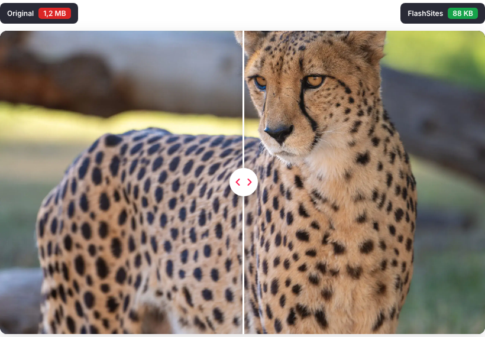

# Your product photos are the heaviest thing on the page

*Source: flashsites.de/en/image-optimization, demo image. Left is the original, right is the optimised version.*

Open any online shop, press the button that shows what the page is made of, and sort by size. On a lot of shops the top of that list is images. Not scripts, not fonts. Photos.

It makes sense. Shops live on photos, and everyone wants them sharp. So someone uploads the original from the camera or the supplier, and the shop happily serves it to a phone on a bad connection.

## Look at the picture above

The photo on the left is 1.2 MB. The one on the right is 88 KB. That's about 93% smaller, and you'd have to squint very hard to see a difference. Our image optimisation page has a slider so you can try it yourself, and you can even upload one of your own images.

We say "up to 92% smaller", and I'd rather be careful with that "up to". It depends on the image. A photo with soft backgrounds compresses more than a very detailed one. But the order of magnitude is real.

## A real shop with a lot of photos

Teppichscheune sells rugs to measure, on Shopware 6. High-resolution photos of rugs are the heart of the shop, and they were also its biggest drag.

On our customers page, the Teppichscheune example shows an image going from 840 KB to 92 KB. That's 89% smaller with the same quality, and the pages now load in about 0.8 seconds instead of 5.

## What actually happens to an image

There are three things going on, and it helps to keep them apart.

**Compression.** Every image is compressed automatically, with no visible loss of quality. This is where most of the savings come from.

**Resizing.** A phone doesn't need a 4000 pixel wide photo. Every device gets the resolution that suits it, which saves a lot on mobile.

**Caching.** Once an image is optimised, it stays in the cache for a long time, so the next visitor gets it instantly instead of waiting for it to be processed again.

We also use modern formats, AVIF and WebP, and combine that with lazy loading so photos further down the page only load when someone scrolls to them.

## If you want to do some of this yourself

Check the size of your biggest images first. If your hero image is over 300 KB, there's almost certainly something to win. Look at what resolution you're uploading compared to what's actually displayed. And try a modern format before spending money on anything else.

If you've got hundreds or thousands of products, doing this by hand is a never-ending job, since every new upload has the same problem. That's why we do it automatically.

You can see what it does for your own images on [our image optimisation page](https://flashsites.de/en/image-optimization), or start the [14 day trial](https://flashsites.de/en/) on your shop.
