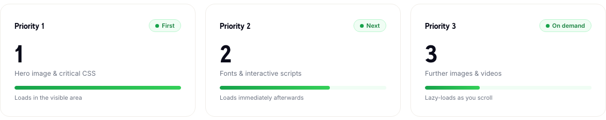

# LCP in plain language: the one number visitors actually feel

*Source: flashsites.de/en/load-order*

If you've looked at a PageSpeed report, you've seen the abbreviation LCP. It stands for Largest Contentful Paint, and it sounds like something only developers should care about. It isn't.

LCP is the time until the biggest thing in the visible part of the page has appeared. On a shop, that's usually the hero image, a banner or the main product photo. In other words, it's the moment the page stops looking empty.

Visitors don't think "the LCP was slow". They think "this is taking forever", and some of them leave.

## What a good and bad one looks like

With Offgridtec, LCP was 4.8 seconds when we started. After the work it was 1.1 seconds, along with a PageSpeed score that went from 45 to 93.

The shop wasn't rebuilt to get there. What changed was how long a visitor stared at a half-finished page.

## Why it's usually slow

The big image is loaded late, or it's stuck behind other things. That's the whole story, more often than not. The browser has a limited amount of attention at any moment, and if it spends that attention on a chat widget, a tracking script and an image in the footer, the hero image waits.

## The fix is about order, not only about weight

You can make the hero image smaller (and you should), but there's a second lever: load it first.

On our load order page we describe three priorities.

**Priority 1: the hero image and the critical CSS.** This is what fills the visible area, so it goes first.

**Priority 2: fonts and interactive scripts.** They load right afterwards.

**Priority 3: everything else.** Further images and videos load as the visitor scrolls.

It's a simple idea, and the effect on LCP is big, since the thing the number measures is the thing we put at the front of the queue.

## Things that quietly hurt your LCP

- A hero image that's lazy loaded. Lazy loading is great for things below the fold, but the first image should never wait.
- Tracking scripts that load before the content does.
- Large fonts that block the text from showing.
- A server that takes a long time to answer in the first place.

The last one is where caching comes in. If the page itself arrives quickly, everything after it starts earlier.

## How to check yours

Run your most important pages through Google PageSpeed and look at the LCP line. Better still, look at real visitor data if you have it. That's what we do, since lab numbers are tidy, and real phones are not.

If your LCP is above about 2.5 seconds, there's room to improve. We can [take a look at your shop](https://flashsites.de/en/) for free during the 14 day trial.
