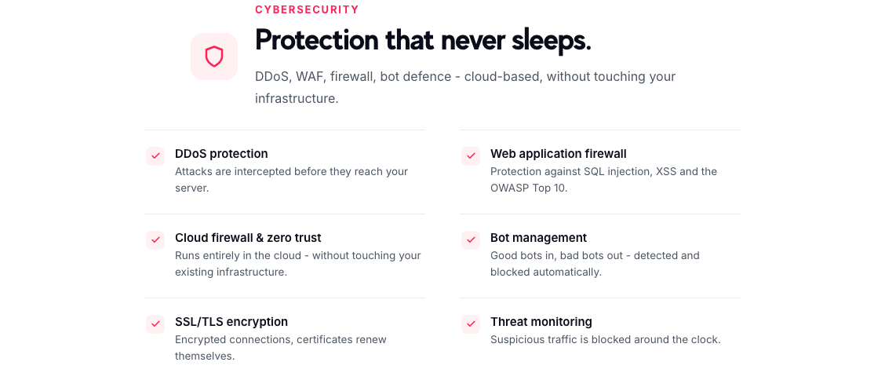

# A fast shop that goes down isn't fast

*Source: flashsites.de/en/more-services*

We spend most of our time on speed, but speed is only useful while the site is up. A shop that loads in half a second and then falls over during a bot attack hasn't helped anyone.

That's why security sits next to performance in what we offer, and why it's worth saying a few plain words about it, even if you're not a technical person.

## The attacks shop owners actually run into

You don't need to be a big brand to be a target. Many attacks are automated: something scans thousands of sites looking for an easy way in, or sends a flood of traffic at whatever it finds.

Here's what that tends to look like for a shop.

**Floods of traffic.** A DDoS attack sends so many requests that real customers can't get through. The site slows down or goes offline, often at the worst moment.

**Bots.** Some bots are fine, like search engines. Others scrape your prices, try stolen passwords on your login page or hammer your checkout. They also use up server capacity you're paying for.

**Application attacks.** Things like SQL injection and cross-site scripting try to trick your shop into doing something it shouldn't. They're on the OWASP Top 10, a well-known list of the most common web risks.

## What we put in front of the shop

All of this runs in the cloud, so nothing has to change on your own infrastructure.

- **DDoS protection** intercepts attacks before they reach your server.
- **A web application firewall** protects against SQL injection, XSS and the rest of the OWASP Top 10.
- **Bot management** lets good bots in and keeps bad bots out, automatically.
- **SSL/TLS encryption** keeps connections encrypted, and certificates renew themselves, so no one has to remember a date.
- **Threat monitoring** blocks suspicious traffic around the clock.
- **A cloud firewall with zero trust**, which also works without touching what you already have.

## Why this fits with speed

There's a practical link. Bad traffic uses the same server capacity as good traffic. If a chunk of your visitors are bots, your real customers are sharing the server with them. Block the bots and the shop has more room to be fast.

And there's a quieter link. When we put a layer between your visitors and your server for caching, it makes sense for that same layer to deal with the junk. Pages get served from the edge, and attacks get stopped at the edge too.

## What I'd check on your own shop

Do you know what share of your traffic is bots? Do your certificates renew automatically, or does someone have to remember? Is anyone looking at your traffic at night or on weekends?

If the answer to any of those is "not sure", it's worth a conversation. You can request a free consultation on our [More Services page](https://flashsites.de/en/more-services), or start with the [speed trial](https://flashsites.de/en/) and we'll take it from there.
