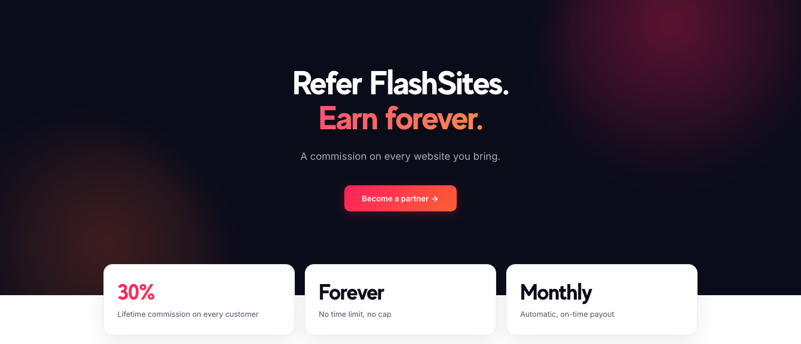
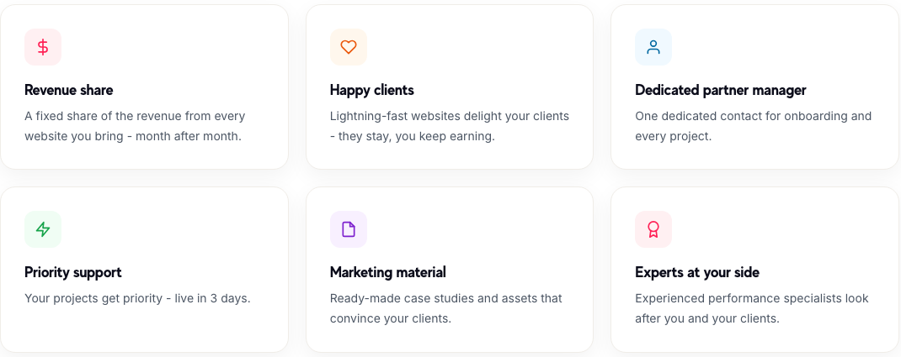

# For agencies and freelancers: a faster shop for every client

*Source: flashsites.de/en/partner*

If you build or look after online shops for other people, you know the conversation. A client's site is slow, they've read that speed matters, and they ask if you can fix it. Meanwhile you have a queue of other work and no desire to become a performance specialist.

This post is for you, and it's partly about how we work with agencies and freelancers.

## The usual problem

Speed work is awkward for an agency. It takes specialist knowledge, it isn't a one-off job, since sites drift back to slow, and it's hard to price. Many agencies end up giving advice they can't back up with results, or they quietly avoid the topic.

## How the partner programme works

You refer a client, we do the speed work, and you get a share of what they pay.

- **30% commission**, for life. As long as the site you referred stays an active FlashSites customer, you're paid every month.
- **No time limit and no cap.**
- **Monthly payouts**, automatic, by bank transfer.
- **Free to join.** No minimum revenue, no hidden fees, nothing binding.

You don't need your own developers for this and there's no risk on your side. The client's shop is typically live in three days.

## What agencies get beyond the commission

*Source: flashsites.de/en/partner*

A dedicated partner manager for onboarding and every project. Priority support on your projects. Ready-made case studies and material to show clients. And experienced performance people looking after you and your clients.

## What agencies tell us

Two partners are quoted on our partner page, and I'd rather let them speak than paraphrase.

Roman Nenstiel, founder of Shrymp Commerce, a Shopify agency: "My clients benefit from the resilience. When Shopify goes down, their shops just keep running. And on PageSpeed they leave everyone behind."

Ivan José Gomes, founder of Gisoro Design Digital: "FlashSites is our insider tip for client projects. The shops load noticeably faster, and support replies in minutes instead of days."

## Is it a fit for you?

Probably, if you work with shops on any of the platforms we support: Shopify, Shopware, WooCommerce, Magento, PrestaShop, plentymarkets, JTL-Shop, BigCommerce, WordPress, Webflow, Wix, Next.js, or a custom build.

The sign-up is a short form on the [partner page](https://flashsites.de/en/partner), and you get an answer within 24 hours.
