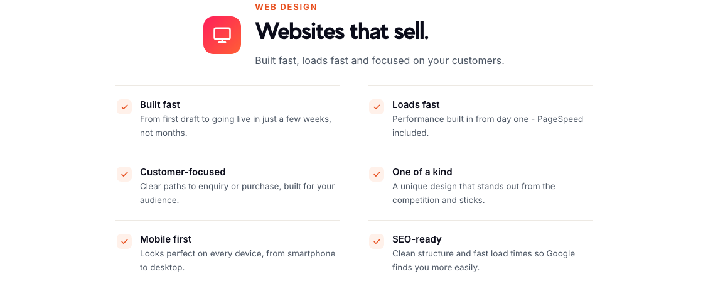

# One partner instead of five: what else we do besides speed

*Source: flashsites.de/en/more-services*

When people first find us, it's usually because their shop is slow. That's fair, speed is what we're known for. But a website has more moving parts than loading time, and in practice the same few problems keep showing up next to it.

So over time we added a few other services. They're on our "More Services" page, and this is a plain-language tour of what each one is for.

## Web design

Websites that sell. The pitch is simple: built fast, so a project takes a few weeks instead of months, and fast to load, with performance built in from day one. They're built mobile first, with clear paths to an enquiry or a purchase, and a clean structure so Google can find them more easily.

It's the one service where we get to start from zero, which means speed doesn't have to be fixed afterwards.

## Cybersecurity

Cloud-based protection that doesn't touch your infrastructure: DDoS protection, a web application firewall, bot management, encryption and round-the-clock threat monitoring. I wrote about this in more detail in [a separate post](7-a-fast-shop-that-goes-down.md).

## Server maintenance

The boring but important one. Updates and patch management, applied without downtime. Round-the-clock monitoring, with alerts within seconds. Automatic encrypted backups that restore quickly. Defined response times for emergencies, and regular health checks and reports that you can read without an IT department.

Most shop owners don't want to think about their server, and shouldn't have to. They want it to work.

## AWS services

For shops that have outgrown simple hosting. Cloud architecture and migration, auto-scaling and load balancing so capacity grows with your traffic on busy days, CDN and edge delivery, safe repeatable releases, and cost optimisation, so your cloud bill doesn't grow faster than your business. Encryption, access control and GDPR compliance are part of it.

## Why bundle them

There's an honest reason, and it isn't "more products". It's that these things affect each other.

Slow pages are partly a hosting problem. A hosting problem is partly a maintenance problem. A traffic spike is a performance problem and a security problem at once. When five different companies each own a piece, nobody owns the whole thing, and you end up as the person relaying messages between them.

Our line on the page is "one provider instead of five", and that's the whole idea.

## A customer's version

Marcel Phillip, owner of Nuvèra, put it this way: "We kept running into load time problems with our shop. FlashSites fixed them for good, and our revenue went up."

We still start with speed, since that's where most customers begin, and you don't have to take anything else. But if you want to talk about more than load times, you can [request a free consultation](https://flashsites.de/en/more-services).
